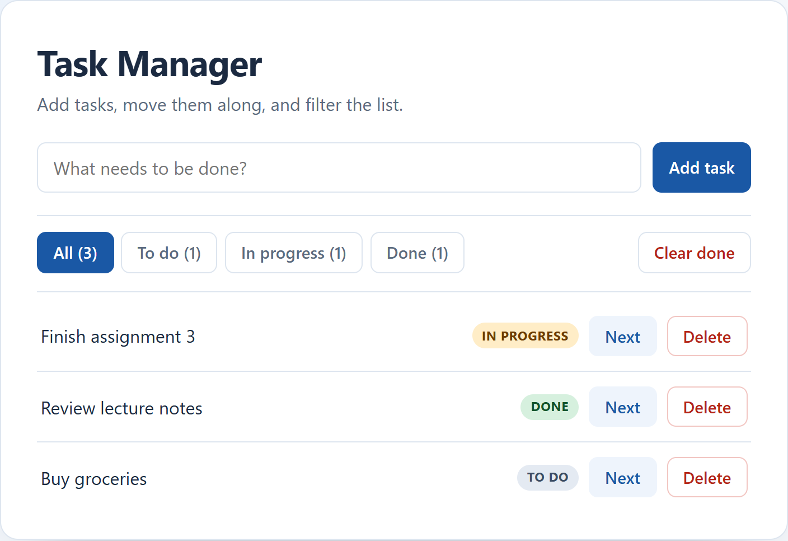
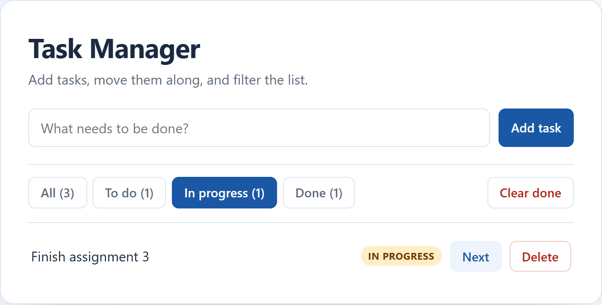

# Assignment 3 — Task Manager with a Reducer

**Olcan Askar**  
Student number: `<fill in>`

MIS 233 Web Based Application Programming, Fall 2026, Week 5.

A small Task Manager built with Vite, React and TypeScript. All state lives in
`App` and is managed by `useReducer`; the reducer is a pure function.

## Run the project

```sh
npm install
npm run dev
npm run build
```

`npm run build` runs TypeScript in strict mode and then the Vite production
build.

## What the app does

- Add a task with the form; the id is created by the caller with
  `crypto.randomUUID()`.
- `Next` advances a task: `todo` → `in-progress` → `done` → `todo`.
- `Delete` removes one task.
- The filter bar shows **All**, **To do**, **In progress** and **Done**, each
  with the number of tasks it would show.
- `Clear done` removes every task whose status is `done` and keeps the current
  filter.
- The visible list and the counts are derived from `{ tasks, filter }` on every
  render; they are never stored in state.

## Files

```
src/
  taskReducer.ts   State, Action, Filter, initialState and taskReducer
  filter.ts        filterTasks and countByFilter (pure, no React)
  TaskRow.tsx      one row: title, status, Next, Delete
  App.tsx          useReducer, AddForm, FilterBar, TaskList
  styles.css       layout and status colours
screenshots/       one screenshot per filter
```

## State and actions

```ts
type State = { tasks: Task[]; filter: Filter }
```

Actions: `add`, `advance`, `remove`, `setFilter`, `clearDone`. The reducer copies
the state object and only replaces the arrays or task objects that change, so
the previous state is never mutated. Every action type is handled in the
`switch`; the `never` check in the `default` branch makes TypeScript report an
error if an action is added without a case.

## Bonus 4: Git repository

https://github.com/olcanaskar/mis233-assignment3

The repository is private; the instructor needs to be added as a collaborator.

## Screenshots

The same three tasks are shown with each filter active:

| Filter | Screenshot |
| --- | --- |
| All |  |
| To do |  |
| In progress |  |
| Done |  |
