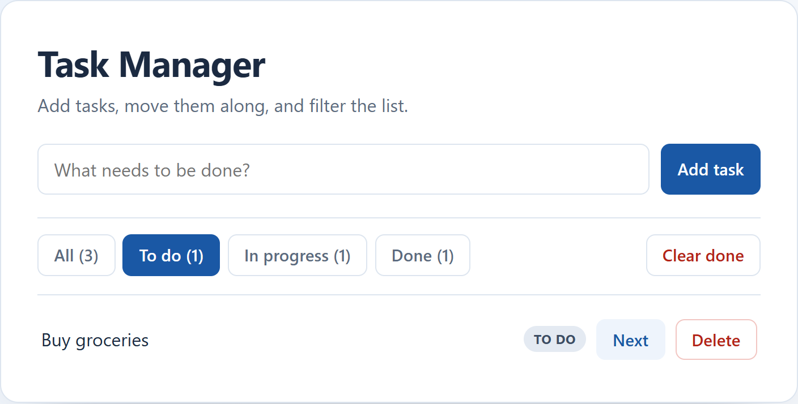
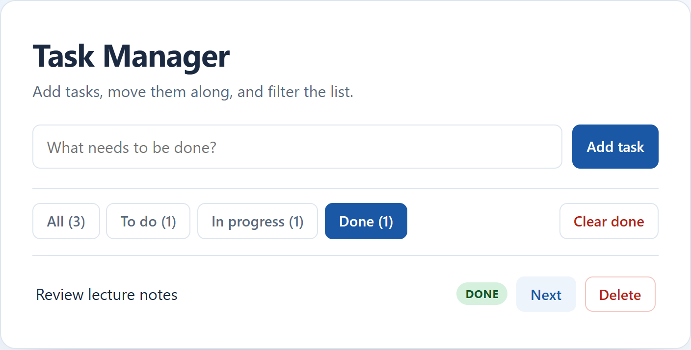

# Assignment 3 — Task Manager with a Reducer

**Olcan Askar**  
Student number: 2024502180

MIS 233 Web Based Application Programming, Fall 2026, Week 5.

A small Task Manager built with Vite, React and TypeScript. All state lives in
`App` and is managed by `useReducer`; the reducer is a pure function.

## Run the project

```sh
npm install
npm run dev
npm run build
npm test
```

`npm run build` runs TypeScript in strict mode and then the Vite production
build. `npm test` runs the Vitest suite.

## What the app does

- Add a task with the form; the id is created by the caller with
  `crypto.randomUUID()`.
- `Next` advances a task: `todo` → `in-progress` → `done` → `todo`.
- `Delete` removes one task.
- `Undo` reverts the last change to the task list.
- The filter bar shows **All**, **To do**, **In progress** and **Done**, each
  with the number of tasks it would show.
- `Clear done` removes every task whose status is `done` and keeps the current
  filter.
- The visible list and the counts are derived from `{ tasks, filter }` on every
  render; they are never stored in state.

## Files

```
src/
  taskReducer.ts   State, Action, Filter, initialState and taskReducer (with undo)
  filter.ts        filterTasks and countByFilter (pure, no React)
  taskReducer.test.ts  reducer tests: actions, undo, purity, edge cases
  filter.test.ts       tests for filterTasks and countByFilter
  TaskRow.tsx      one row: title, status, Next, Delete
  App.tsx          useReducer, AddForm, FilterBar, TaskList
  styles.css       layout and status colours
screenshots/       one screenshot per filter
```

## State and actions

```ts
type State = { tasks: Task[]; filter: Filter; past: Task[][] }
```

Actions: `add`, `advance`, `remove`, `setFilter`, `clearDone`, `undo`. The reducer
copies the state object and only replaces the arrays or task objects that
change, so the previous state is never mutated. Every action that changes
`tasks` pushes the old task list onto `past`; `setFilter` does not. `undo` pops
the last list back and leaves the filter unchanged. Every action type is handled
in the `switch`; the `never` check in the `default` branch makes TypeScript
report an error if an action is added without a case.

## Bonus 1: Undo

The state is `{ tasks, filter, past }`, where `past` is a `Task[][]` stack of the task lists before each task-changing action. `add`, `advance`, `remove` and `clearDone` push the old list; `setFilter` does not. `undo` pops the most recent list back into `tasks`, and the Undo button is disabled while `past` is empty.

## Bonus 2: Tests

The Vitest suite covers every reducer action, three advances returning a task to `todo`, the undo history, immutability (the state is frozen with `Object.freeze`), `filterTasks` and `countByFilter`, and edge cases such as an unknown id, an empty list, `clearDone` with nothing done, and counts after a delete.

Output of `npm test`:

```text
> task-manager-assignment3@0.0.0 test
> vitest run

 RUN  v5.1.0 C:/Projects/assignment3

 Test Files  2 passed (2)
      Tests  26 passed (26)
   Start at  23:53:23
   Duration  252ms (transform 44%, import 41%, tests 9%, worker 5%)
```

## Bonus 3: Explain your reducer

A reducer must be pure because React compares the returned value with the previous one to decide what changed. If it mutates the old state and returns the same object, the references are identical, so React can skip the update and show stale data. Mutation would also break undo, because `past` would point at arrays that keep changing. A pure reducer takes the old state, returns a new object, and leaves the old one untouched; that makes it predictable and easy to test.

The caller creates the id with `crypto.randomUUID()` because the reducer must produce the same result for the same input. If the reducer generated it, two calls with the same action could produce different tasks. React may call a reducer twice in StrictMode to check purity, so generating the id inside would be a bug. The event handler creates the id once and puts it in the action.

The filtered list and counts are derived while rendering because they are not independent facts; they are calculated from `tasks` and `filter`. Storing them creates a second source of truth. For example, if `counts` were stored and I deleted a done task while the Done filter was active, `tasks` would lose it but the stored count could still say `Done (1)`, so the screen would contradict itself. Recomputing from `tasks` makes that impossible.

Moving the filter into the reducer instead of a separate `useState` made the state easier to reason about: one `dispatch({ type: 'setFilter' })` updates the filter through the same rulebook as every other change, and `undo` can leave the filter alone. The harder part is that every task-changing action now copies the state object and remembers history, so the reducer has more responsibilities than the sample.

## Bonus 4: Git repository

https://github.com/olcanaskar/mis233-assignment3

The repository is public, so the instructor can open the link directly.

## Screenshots

The same three tasks are shown with each filter active:

| Filter | Screenshot |
| --- | --- |
| All |  |
| To do |  |
| In progress |  |
| Done |  |
